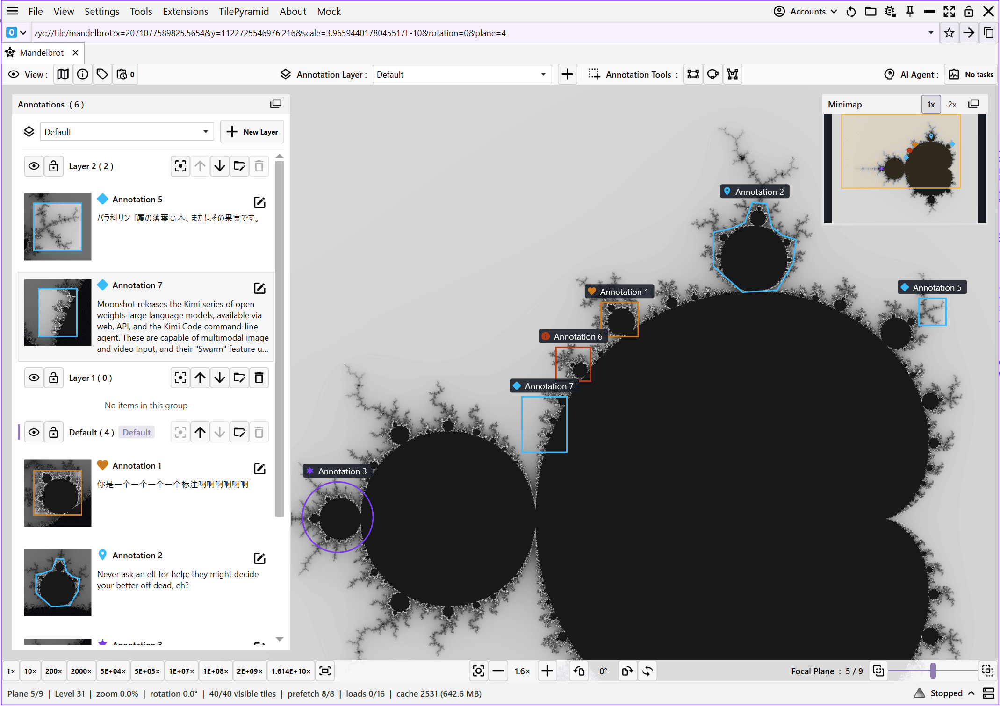
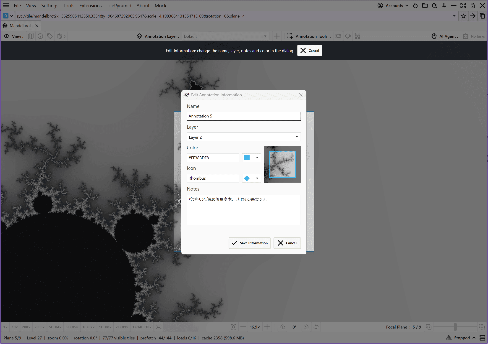
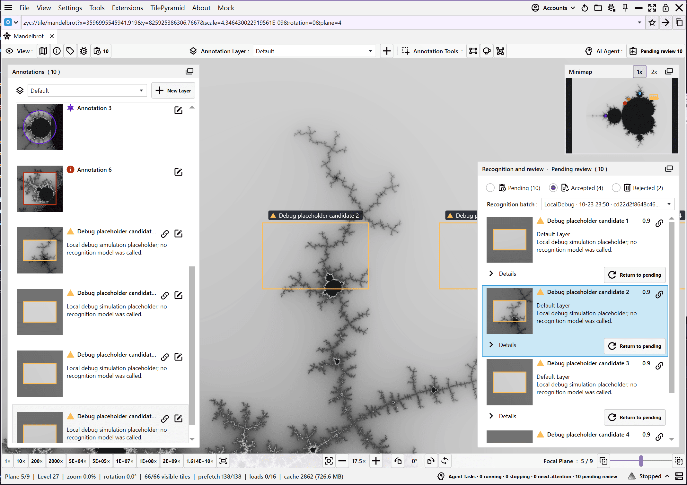

<h1 align="center">ZYC.TilePyramid.Agent</h1>

<p align="center">
  <b>A Windows desktop workspace for large images, annotations, and agent-assisted review.</b>
</p>

<p align="center">
  <a href="https://www.nuget.org/packages/ZYC.Framework.Modules.TilePyramid">
    
  </a>
  <a href="https://www.nuget.org/packages/ZYC.Framework.Modules.TilePyramid">
    
  </a>
  
  
  <a href="LICENSE">
    
  </a>
</p>

<p align="center">
  <a href="https://github.com/ZiYuCai1984/ZYC.TilePyramid.Agent/actions/workflows/publish-nuget-manual.yml">
    
  </a>
</p>

Explore image pyramids and whole-slide images, organize annotations in layers, and review recognition results alongside the source image. External agents can inspect image regions and submit results through the Model Context Protocol (MCP), while users track progress and decide when an agent may control the viewport.

Built with **C#**, **.NET 10**, and **WPF**, as a module for [ZYC.Framework](https://github.com/ZiYuCai1984/ZYC.Framework).



*The built-in Mandelbrot demo with layered annotations and a minimap.*

## What you can do

- **Explore large images:** pan, zoom, rotate, navigate with a minimap, and switch focal planes when the source provides them.
- **Annotate regions:** draw rectangles, ellipses, and polygons; edit their geometry, labels, colors, icons, and notes.
- **Organize layers:** create, rename, reorder, hide, and lock annotation layers, with region thumbnails for navigation.
- **Work with agents:** expose loaded documents, image crops, layers, annotations, and recognition tasks through MCP.
- **Review recognition results:** browse batches, inspect original model scores, accept or reject results, and turn accepted results into editable annotations.
- **Keep your work:** restore document state, annotations, layers, recognition results, and review decisions across sessions.

## A typical workflow

1. **Open an image.** Choose a supported local file, or try the built-in Mandelbrot demo.
2. **Explore and annotate.** Navigate to a region, choose a layer, and add manual annotations.
3. **Let an agent inspect it.** An external agent reads image crops and submits recognition candidates to a batch. Progress appears in the Agent tasks panel.
4. **Review in context.** Inspect candidate thumbnails and overlays, then accept or reject each result. Accepted results become editable annotations linked to the original recognition data.

Recognition runs in the background. Viewport control is a separate request that the user can grant or revoke. New tasks require review by default; `TilePyramidConfig.AutoAcceptRecognitionResults` can enable automatic acceptance for subsequently created tasks.

### Annotations and layers



*Edit an annotation's properties with a preview of the selected region.*

### Recognition and review



*The Accepted view with linked annotations and controls to return results to pending review. This example uses simulated recognition results.*

## Supported image sources

| Source | Files or input | Access |
| --- | --- | --- |
| TIFF / BigTIFF / OME-TIFF | `.tif`, `.tiff` | Local files or HTTP(S) |
| Aperio SVS | `.svs` | Local files or HTTP(S) |
| Hamamatsu | `.ndpi`, `.vms`, `.vmu` | Local files |
| MIRAX | `.mrxs` and its companion data directory | Local files |
| Deep Zoom | `.dzi`, `.xml` descriptors and their tiles | Local files or HTTP(S) |
| Generated images | Mandelbrot and sine/cosine demos | Built in; Mandelbrot also supports an HTTP tile source |

Remote TIFF and SVS sources require a server that supports HTTP byte-range requests. Hamamatsu and MIRAX use the bundled Windows x64 OpenSlide runtime. Keep companion files and directories together for multi-file slide formats.

Focal planes and associated images depend on the source. OME-TIFF uses the selected main image's first channel and time point, with its Z stack contained in the same file.

## Installation

Install the module in the ZYC.Framework Demo, or build this repository locally.

### Requirements

- Windows x64.
- The .NET 10 SDK, with `dotnet` available on your PATH. The Demo's module installer also uses the SDK to restore NuGet dependencies.
- Access to NuGet to download the module and its dependencies.
- Git if building from source.

### Option 1: Install in the ZYC.Framework Demo

1. Download and install the Demo using **Download Demo Installer** in the [ZYC.Framework README](https://github.com/ZiYuCai1984/ZYC.Framework). Installers are also available on the [releases page](https://github.com/ZiYuCai1984/ZYC.Framework/releases).
2. Launch ZYC.Framework and open **Extensions → NuGet Modules**.
3. Select **[`ZYC.Framework.Modules.TilePyramid`](https://www.nuget.org/packages/ZYC.Framework.Modules.TilePyramid)** in the package list and click **Install**. Use **Refresh** to reload the list if needed.
4. Restart ZYC.Framework when prompted. The **TilePyramid** menu will be available after the module loads.

### Option 2: Build locally

```powershell
git clone https://github.com/ZiYuCai1984/ZYC.TilePyramid.Agent.git
cd ZYC.TilePyramid.Agent

.\build.cmd

cd .\_bin\app
.\ZYC.Framework.exe
```

Dependencies are restored automatically from NuGet. The build script prepares the Framework host through `Entry`, builds the module, and creates NuGet packages in `_bin/app`. The same directory contains the runnable application.

### Open your first image

In the application, choose **File → Open → TilePyramid** to open a local image, or **TilePyramid → Mandelbrot** to explore without a sample file. The document toolbar provides annotation tools, panel toggles, and Agent task status.

## Agent integration

The module exposes tools under the **`TilePyramid`** MCP name through the Framework host. Connect your MCP client to the host's configured MCP endpoint. Connection and transport settings belong to the host.

The external agent or executor supplies the model calls. This module provides image access, task tracking, result submission, and review.

| Capability | Service methods |
| --- | --- |
| Discover loaded tabs and inspect the viewport | `ListDocumentsAsync`, `GetDocumentInfoAsync`, `GetViewportAsync` |
| Read a region as PNG with coordinate metadata | `ReadRegionAsync` |
| Read and organize annotations and layers | `GetAnnotationsAsync`, `UpdateAnnotationAsync`, `GetLayersAsync`, `CreateLayerAsync`, `MoveAnnotationsToLayerAsync` |
| Start a batch and submit recognition results | `BeginRecognitionAsync`, `SubmitCandidatesAsync`, `EndRecognitionAsync` |
| Track progress and handle cancellation | `GetTasksAsync`, `ReportTaskProgressAsync`, `RequestTaskCancellationAsync`, `AcknowledgeTaskCancellationAsync` |
| Request and release viewport control | `RequestViewportControlAsync`, `SetViewportAsync`, `ReleaseViewportControlAsync` |
| Review results | `GetRecognitionFeaturesAsync`, `AcceptRecognitionAsync`, `RejectRecognitionAsync`, `ResetRecognitionReviewAsync` |

A recognition executor follows this sequence:

1. Find a loaded document and call `BeginRecognitionAsync`. The task fixes its region, focal plane, target layer, and automatic acceptance policy.
2. Read regions with `ReadRegionAsync`, supplying the returned task ID, and run the chosen model externally.
3. Call `ReportTaskProgressAsync` at least every 30 seconds, including while a model call is in progress. Tasks have a 120-second lease; stop work when the returned state is no longer `Running`.
4. Submit candidates with stable IDs through `SubmitCandidatesAsync`. Use full-resolution image coordinates, or supply a returned crop ID to submit coordinates relative to that crop.
5. Call `EndRecognitionAsync` on success, `FailTaskAsync` on failure, or `AcknowledgeTaskCancellationAsync` after stopping in response to cancellation. Partial results remain available for review.

Image crops are unrotated, contain no annotation overlays, and have a maximum output size of 1024 × 1024 pixels. A document ID identifies an open tab; recognition results and saved annotations are shared by tabs showing the same image. Scores retain the model's original numeric scale.

For the complete contracts, see [the agent service](ZYC.Framework.Modules.TilePyramid.Abstractions/Agent/ITilePyramidAgentService.cs), [task and viewport control](ZYC.Framework.Modules.TilePyramid.Abstractions/Agent/ITilePyramidAgentService.Tasks.cs), and [the MCP image adapter](ZYC.Framework.Modules.TilePyramid/ITilePyramidAgentImageTools.cs).

## Saved state

For local files, document state is stored beside the image in `.zyc/<image-file-name>.tilepyramid.json` under the default Framework URI scheme. Remote sources and built-in demos use the Framework settings store.

Recognition records preserve the original result and its review decision. Editing an accepted annotation does not rewrite the original recognition result. Live Agent tasks belong to the current application session.

## Repository layout

| Path | Purpose |
| --- | --- |
| `Entry/` | Restores and stages the Framework host; provides the launcher |
| `ZYC.Framework.Modules.TilePyramid/` | WPF workspace, document management, annotation tools, review UI, and agent services |
| `ZYC.Framework.Modules.TilePyramid.Abstractions/` | Public contracts, configuration, routes, and agent DTOs; targets `net10.0` without WPF |
| `ZYC.TilePyramid.Build.NuGet/` | Build and NuGet packaging utility invoked by `build.cmd` |
| `build.cmd` | Builds the application and packages into `_bin/app` |
